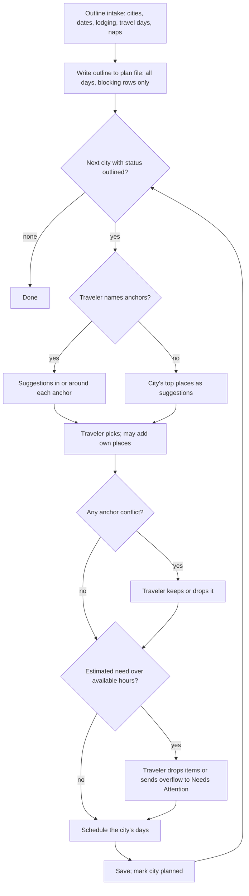

# Anchor-First Trip Planning - Plan

## Goal Capsule

- **Objective:** Make the traveler's own must-visit places (neighborhoods, attractions, or day-trip towns) the backbone of each city's plan, with nearby suggestions the traveler picks from before anything is scheduled, across single- and multi-city trips.
- **Product authority:** The Product Contract below, then the Planning Contract's KTDs. Other intake improvements discussed alongside it (interests, pace, transport mode, meal times, research-only mode, family profile) are not active scope.
- **Execution profile:** Methodology prose in `core/`, the Claude Code skill, one worked example, and converter tests. The converter's code does not change (R17).
- **Stop conditions:** Stop and ask if a change would need `tools/md-to-ics/md_to_ics.py` code changes, or would name a tool or platform inside `core/`.
- **Tail ownership:** No commits without the user's explicit "OK to commit" (user's global instructions). Each unit should still be a coherent commit-sized change.
- **Open blockers:** None.

---

## Product Contract

Product Contract preservation: added R19 for anchor conflict handling and R18 for day-trip towns. R6 keeps its original intent, reworded from "always kept" to "never dropped silently" so that R19 can apply. R18's full day applies only when naps can happen on the go. The user approved these at plan scoping and plan review. AE7, AE8, and AE9 are new. All other R/F/AE IDs and their meaning are unchanged.

### Summary

Intake first sets up the trip outline: cities, days in each, lodging, travel days, and whether naps can happen on the go. Then, city by city, the agent asks for must-visit places. It suggests places in or around them (or the city's top places when none are named), lets the traveler pick, checks the picks against that city's available time, and schedules those days.

### Problem Frame

Travelers usually arrive with a few places they already care about: a neighborhood a friend raved about, an attraction they've wanted to see for years. Today the methodology collects these only as constraints to "work around rather than duplicate or override" (`core/intake-questions.md`). It then researches candidates from scratch and builds each day around the lodging (`core/itinerary-and-pacing.md`). The places the traveler cares most about end up fitted into a plan shaped by someone else's rankings. The flow also assumes one lodging base, so a trip like "3 days Lisbon, then 2 days Porto" has no natural shape.

### Key Decisions

- **The traveler picks suggestions before anything is scheduled.** Nothing lands in the plan that the traveler didn't name or pick. Governs R9, R10. (session-settled: user-directed — chosen over auto-filling the schedule with alternates listed, and over scheduling only anchors with an unscheduled ideas list: the traveler stays in control of what's in the plan)
- **Multi-city trips are in scope.** Each city's anchors and picks land only on that city's days. Governs R1, R12, R16. (session-settled: user-directed — chosen over single-city only and over single-city-designed-for-later: real trips span cities)
- **The plan is built city by city.** The trip outline comes first, then each city runs anchors → suggestions → picks → capacity check → schedule → save. Governs R1, R15. (session-settled: user-approved — chosen over collecting all cities' anchors up front and over a menu-first flow: shorter pick lists, per-city capacity, resumable sessions)
- **Capacity is checked at pick time.** Overflow is caught while the traveler is still choosing. Governs R11. (session-settled: user-approved — chosen over scheduling by priority and reporting cuts afterwards, and over ranking everything up front)
- **Intake asks whether naps can happen on the go.** The answer decides whether a far anchor gets a full day or a half day. Governs R2, R13. (session-settled: user-approved — chosen over always napping at the lodging and over treating rest as a blocked time anywhere)
- **Traveler-named places skip the "worth the detour" bar.** Distance affects only the time budget. Governs R6. (session-settled: user-approved — chosen over applying the same bar as agent suggestions: the traveler already chose them)
- **Conflicting anchors go back to the traveler.** An anchor that can't work is flagged, not dropped and not silently scheduled. Governs R19. (session-settled: user-approved — chosen over scheduling every anchor regardless: a confirmed incompatibility or impossible fit needs the traveler's call)
- **A day-trip town is an anchor, not an outline stop.** Governs R18. (session-settled: user-approved — chosen over making it its own city in the trip outline: the family keeps one lodging and the town takes a full day)
- **A day-trip town with a bed nap goes back to the traveler.** Governs R18. (session-settled: user-approved — chosen over always giving it a full day and over always a half day: the traveler weighs the skipped nap against a shorter visit)
- **A city with no named places still gets a pick list.** The list shows the city's top places, so every city follows the same flow. Governs R8. (session-settled: user-approved — chosen over the agent choosing for them)
- **Meals and logistics are not suggestions.** They keep the pick list about places worth choosing, not routine slots. Governs R10.

### Requirements

**Trip outline (intake)**

- R1. Before researching any places, intake establishes the trip outline: each city in order, the dates spent in each, lodging per city (or "not booked yet"), and the travel days between cities.
- R2. Intake asks whether the group's nap or rest can happen on the go (stroller, car, carrier) or needs a bed at the lodging.
- R3. Questions with a small fixed set of likely answers are offered as choices; open answers (cities, dates, addresses, place names) stay free text.

**Anchors (per city)**

- R4. For each city, the agent asks whether there are specific places there the traveler plans to visit; an answer may be a neighborhood or an attraction (an anchor).
- R18. An anchor may also be a day-trip town outside the city; its suggestions are places in that town, and it takes a full day when naps can happen on the go, otherwise the agent offers a full day without the bed nap or a half-day visit and the traveler chooses.
- R5. When the agent can't tell what kind of anchor a place is, or can't find it, it asks the traveler instead of guessing.
- R6. Traveler-named anchors are never dropped silently, and distance from lodging affects only how much day they take (R13).
- R19. When an anchor conflicts with a stated need or a hard exclude, or can't fit in the city's days, the agent says so at pick time and the traveler decides whether to keep it; a kept anchor that still can't be scheduled goes to Needs Attention.

**Suggestions and picking**

- R7. Suggestions for a neighborhood anchor are places inside it; for an attraction anchor, places within walking range of it. Both follow the existing hard-exclude, ranking, and corroboration rules.
- R8. For a city with no anchors, suggestions are the city's highly recommended places and neighborhoods.
- R9. Suggestions are shown grouped by anchor, each with a one-line reason and a rough time needed; the traveler picks which to include and may add places of their own, which become anchors.
- R10. Nothing is scheduled that the traveler neither named nor picked, except travel, rest, bedtime, and meal slots; a meal slot names a venue only when the traveler named or picked one.

**Capacity check**

- R11. After picking and before scheduling, the agent compares the estimated time for that city's anchors, picks, and travel between them against the city's available hours (after blocking windows); if it's over, it shows the gap and asks the traveler to drop items or accept that the overflow goes to Needs Attention.

**Scheduling**

- R12. Each city's days are built around its anchors and picks, grouping items near the same anchor on the same day; nothing from one city lands on another city's days.
- R13. An anchor beyond walking range of lodging gets a full day with an on-the-go rest row when naps can happen on the go, and otherwise a half-day block before or after the lodging rest window, with travel both ways budgeted.
- R14. An anchor with day or hour constraints (closed days, limited hours) lands on a day it's open; if no day in that city works, it goes to Needs Attention and Open Questions.
- R15. Each city's days are written to the plan file before the next city starts, so an interrupted session resumes at the next unplanned city.

**Plan document**

- R16. The plan records lodging per city and which city each day is in.
- R17. Calendar export keeps working unchanged; cities in different time zones use the existing per-day timezone override.

### Key Flows

- F1. Plan a multi-city trip
  - **Trigger:** Traveler starts the planner for a new trip.
  - **Steps:** Trip outline intake (R1-R3). Then, for each city in order: ask for anchors (R4, R18, R5); research suggestions per anchor, or top places if none (R7-R8); traveler picks and may add places (R9); flag anchor conflicts (R19); capacity check (R11); schedule the city's days (R12-R14); save (R15).
  - **Outcome:** A plan file with every city scheduled, built around places the traveler named or picked.
  - **Covered by:** R1-R19

### Acceptance Examples

- AE1. **Covers R6, R13.** **Given** an anchor 45 minutes from the lodging and a nap that needs a bed, **when** the city is scheduled, **then** the anchor gets a morning or afternoon block with travel both ways, and the nap row is at the lodging.
- AE2. **Covers R13.** **Given** the same anchor and naps that can happen on the go, **when** the city is scheduled, **then** the anchor can take a full day with an on-the-go rest row at the anchor.
- AE3. **Covers R8, R9.** **Given** a city where the traveler names no places, **when** suggestions are shown, **then** they're the city's top places, and only the ones the traveler picks are scheduled.
- AE4. **Covers R11.** **Given** picks totalling about 14 hours against about 9 available hours in a city, **when** picking ends, **then** the agent shows the gap and asks what to drop before scheduling anything.
- AE5. **Covers R14.** **Given** an anchor that's closed on every day the traveler is in that city, **when** the city is scheduled, **then** it appears under Needs Attention and Open Questions with the reason, not in a day.
- AE6. **Covers R5.** **Given** an anchor name the agent can't find, **when** anchors are collected, **then** the agent asks the traveler to clarify instead of guessing a place.
- AE7. **Covers R19.** **Given** a wheelchair user and an anchor confirmed to be stairs-only, **when** picks are shown, **then** the agent names the conflict and asks whether to keep it, and doesn't schedule it unless the traveler keeps it.
- AE8. **Covers R18.** **Given** a Lisbon stay, naps that can happen on the go, and the anchor "Sintra", **when** suggestions are shown, **then** they are places in Sintra, and Sintra takes one full Lisbon day.
- AE9. **Covers R18.** **Given** the same stay but a nap that needs a bed, **when** picks are shown, **then** the agent offers a full Sintra day without the bed nap or a half-day visit, and schedules the traveler's choice.

### Scope Boundaries

- Other intake improvements: interests, pace, transport mode, and meal times.
- A research-only mode for quick questions without building a plan.
- A saved family profile carried across trips.
- Searching or booking transport between cities beyond the existing flight-search flow; travel days are scheduled as rows only.
- Changes to the calendar converter's code.

### Sources

- `core/intake-questions.md`: question 5, "Anything already decided", is the current home of traveler-named places.
- `core/itinerary-and-pacing.md`: "Cluster by walking distance from a base" (lodging-centered, ~1200 m default) is the rule anchors replace as the day's center.
- `core/research-methodology.md`: "The 'worth the detour' judgment call" applies to places beyond the lodging's walking radius, and has no exemption for traveler-named places today.
- `core/output-format-spec.md`: `lodging` is a single object today; the per-day timezone override (" · <IANA zone>") already exists and the calendar converter ignores `lodging`.
- `tools/md-to-ics/md_to_ics.py`: `DAY_HEADING_RE` accepts any text between the date and an optional `·` zone; `find_table_after` accepts a table with a header and separator but zero rows.

---

## Planning Contract

### Key Technical Decisions

- KTD1. **The plan file is the session state, written right after intake.** Write the frontmatter and every `## Day N` heading as soon as the outline is known, with each day's table holding only its blocking rows (rest, bedtime, travel). Each city carries `status: outlined` or `status: planned` in frontmatter, and resume starts at the first `outlined` city. Covers R15, R16. (session-settled: user-approved — chosen over writing nothing until a city is fully scheduled: an interrupted session loses nothing and export works on a half-finished plan)
- KTD2. **Lodging per city lives in a `cities` frontmatter list.** Each entry holds name, dates, optional timezone, lodging, and status. The trip-wide `timezone`, `destination`, `start_date`, and `end_date` stay required: `timezone` is the first city's zone, and the dates span the whole trip. A trip-level `naps_on_the_go` field records the R2 answer and is `false` when the question isn't asked. A city whose zone differs from the trip zone carries it as the ` · <zone>` suffix on every one of its day headings, because the converter reads zones only from headings and cells. A plan with the old single `lodging` field reads as a one-city trip. Covers R1, R2, R16, R17.
- KTD3. **The day heading names its city.** Format: `## Day N — YYYY-MM-DD (Weekday) — <City>`, then the optional ` · <IANA zone>`. The converter already parses this; new tests pin it. City names must not contain `·`. Covers R16, R17.
- KTD4. **The anchor/pick record lives in Destination Research, per city.** Each city gets three lists: named by the traveler, picked from suggestions, and suggested but not picked. The day tables stay unchanged. Revisions read these lists to know what must not be dropped. Covers R6, R9, R19.
- KTD5. **One new core doc owns the per-city loop.** `core/city-planning-loop.md` states the anchor → suggestion → pick → conflict → capacity → save steps. Existing docs cite it instead of restating it, and `core/research-methodology.md` keeps ranking and the detour bar, adding only the anchor exemption. Covers R4-R11, R15, R18, R19.
- KTD6. **The capacity check is a stated estimate.** Available hours are each day's pacing windows minus blocking windows, meals, and already-booked items. Needed hours are each item's rough duration plus travel between items. Both are shown with "about" wording, and only a clear overrun triggers the drop-or-overflow question. Covers R11.
- KTD7. **A travel day belongs to the arrival city.** Its free hours count toward the arrival city's capacity, its heading uses the arrival city's zone, and the transit row uses per-cell zones. Its rest row is on the go or at the arrival lodging, per the R2 answer. Every row before arrival names the departure city's zone in its time cells, so it doesn't convert in the arrival zone. Covers R1, R12, R17.
- KTD8. **The Claude Code adapter picks with multiple-choice questions.** The picker takes 2-4 options per question, so an anchor's suggestions (or a no-anchor city's top places) are split across as many 4-option multi-select questions as needed, at most 4 questions per prompt. A single suggestion is asked as keep/skip. An anchor with no suggestions is reported, with an offer to add the traveler's own places. The free-text "Other" answer adds the traveler's own places. `core/` says only "offer suggestions as choices the traveler can tick". Covers R3, R9.
- KTD9. **A revision reruns only the affected city.** Changing a city's anchors or dates reruns that city's loop, and other cities keep their picks. A date change renumbers every later `Day N` heading. Covers R12, R14, R15. (session-settled: user-approved — chosen over replanning the whole trip: earlier cities keep the traveler's choices)
- KTD10. **A date change rechecks every city it moves.** Each city whose dates shift keeps its picks but reruns the open-day check (R14) and the capacity check (R11); if the trip's total length is fixed, the agent asks which city gains or loses the day. Covers R11, R14. (session-settled: user-approved — chosen over keeping moved cities' rows as-is: a place could otherwise land on a closed day without notice)

### High-Level Technical Design

The per-city loop (owned by KTD5). The outline is written first (KTD1); each city then runs:



Directional shape of the new frontmatter (KTD2); exact keys may change in U1:

```yaml
trip_name: "Family Trip to Lilliput and Blefuscu"
destination: "Lilliput and Blefuscu"
start_date: 2026-11-10
end_date: 2026-11-13
timezone: "Europe/London"   # first city's zone
naps_on_the_go: false
cities:
  - name: "Lilliput"
    start_date: 2026-11-10
    end_date: 2026-11-11
    lodging: { name: "Hotel Lilliput Central", address: "1 Main Square, Lilliput" }
    status: planned
  - name: "Blefuscu"
    start_date: 2026-11-12
    end_date: 2026-11-13
    timezone: "Europe/Paris"
    lodging: { name: "Blefuscu Harbour Inn", address: "not booked yet" }
    status: outlined
```

### Assumptions

- Pacing windows (nap, bedtime) are local clock times in whichever city the day is in.
- Returning to an earlier city (Lisbon → Porto → Lisbon) is a separate stop in the outline.
- A place the traveler adds while picking gets the same R5 clarification and R19 conflict check as one named up front, but no new round of suggestions.
- Needs Attention and Open Questions stay single sections, with each item labeled by its city.

---

## Implementation Units

### U1. Multi-city trip-file format

- **Goal:** Define the trip-file shape for cities, per-city lodging and status, the city in day headings, and the per-city anchor/pick record.
- **Requirements:** R15, R16, R17; KTD1, KTD2, KTD3, KTD4, KTD7.
- **Dependencies:** None.
- **Files:**
  - Modify `core/output-format-spec.md`.
  - Modify `tools/md-to-ics/test_md_to_ics.py`.
- **Approach:**
  1. Replace the single `lodging` example with the `cities` list and `naps_on_the_go`, keeping the trip-wide required fields per KTD2; document old single-`lodging` files as one-city trips.
  2. Add the city to the day-heading pattern, before the zone override, and forbid `·` in city names.
  3. Add per-city "named / picked / suggested but not picked" lists under Destination Research.
  4. Allow a day table with only blocking rows, or no rows, for days of an `outlined` city.
  5. Update "Converter contract" to say the new fields are ignored, and update "Time zones" with the per-city heading suffix rule (KTD2) and the travel-day departure-zone rule (KTD7).
- **Execution note:** Characterization-first. Write the converter tests against the new shapes before editing the spec, and confirm they pass without converter changes. A failing one means the stop condition fires.
- **Patterns to follow:** The existing "Time zones" section and test helpers `plan()`/`day()` in `tools/md-to-ics/test_md_to_ics.py`.
- **Test scenarios:**
  - A heading `## Day 1 — 2026-11-10 (Tuesday) — Lilliput` parses as one day with the trip zone.
  - A heading `## Day 3 — 2026-11-12 (Thursday) — Blefuscu · Europe/Paris` uses Europe/Paris for its unmarked times.
  - A day table with header and separator but no rows converts with zero events for that day and no error.
  - A two-city plan with a `cities` frontmatter list and no top-level `lodging` converts.
  - A frontmatter with the old single `lodging` field still converts (backward compatibility).
- **Verification:** All converter tests pass with `md_to_ics.py` unchanged, and the spec describes every field the new tests use.

### U2. Trip-outline intake

- **Goal:** Rewrite intake to establish the trip outline first, ask the on-the-go nap question, and offer fixed-answer questions as choices.
- **Requirements:** R1, R2, R3; KTD2, KTD7.
- **Dependencies:** U1.
- **Files:** Modify `core/intake-questions.md`.
- **Approach:**
  1. Replace the single destination/lodging questions with the outline: cities in order, dates per city, lodging per city, and travel days.
  2. Ask the on-the-go nap question only when the traveler reports a nap or rest window; otherwise record `naps_on_the_go: false` (KTD2).
  3. Move "anything already decided" so that fixed bookings stay here, and must-visit places move to the per-city loop (`core/city-planning-loop.md`).
  4. Add a generic rule to offer likely answers as choices for fixed-answer questions.
  5. State that the outline is written to the plan file right after intake (KTD1).
- **Patterns to follow:** The existing "Always ask / Ask only if relevant / What NOT to do" structure.
- **Test scenarios:** Walk-through only; prose has no automated test. Check each against the edited doc:
  - A one-city trip still needs exactly one city entry and no travel-day question.
  - A traveler with no nap window is never asked the on-the-go question.
  - A traveler who skips lodging gets "not booked yet" and an Open Questions item, not a re-ask.
- **Verification:** Every intake question maps to R1, R2, R3, or an existing rule, and `grep -rniE 'claude|codex|perplexity|google|goat|tabelog' core/` stays empty.

### U3. Per-city planning loop

- **Goal:** Add the doc that owns anchors, suggestions, picks, conflicts, the capacity check, and per-city saves, and link it from research methodology.
- **Requirements:** R4-R11, R15, R18, R19; KTD4, KTD5, KTD6.
- **Dependencies:** U1, U2.
- **Files:**
  - Create `core/city-planning-loop.md`.
  - Modify `core/research-methodology.md`.
- **Approach:**
  1. Write the loop as ordered steps matching the High-Level Technical Design.
  2. State anchor types (neighborhood, attraction, day-trip town) and the clarify-instead-of-guess rule.
  3. Define suggestion scope per anchor type, and the no-anchor top-places list.
  4. Describe pick presentation generically: grouped by anchor, one-line reason, rough time, choices plus free-text additions; an anchor with no suggestions is reported with an offer to add places.
  5. State the conflict rule from R19, and the day-trip choice from R18 when the nap needs a bed.
  6. Define the capacity estimate per KTD6 and the drop-or-overflow question.
  7. Mark the city `planned` after saving (KTD1).
  8. In `research-methodology.md`, add one line exempting traveler-named anchors from the detour bar, citing the loop doc; leave ranking rules unchanged.
- **Patterns to follow:** The voice of `core/research-methodology.md` and its "never silently drop / never fabricate" phrasing.
- **Test scenarios:** Walk-through against the edited docs:
  - Covers AE3: a city with no anchors shows top places, and only picks are scheduled.
  - Covers AE4: a 14-hour pick set against 9 available hours triggers the drop-or-overflow question before scheduling.
  - Covers AE6: an unfindable anchor triggers a clarifying question.
  - Covers AE7: a stairs-only anchor for a wheelchair user is flagged, not scheduled unless kept.
  - Covers AE8: "Sintra" from Lisbon with on-the-go naps yields Sintra suggestions and a full Lisbon day.
  - Covers AE9: the same with a bed nap offers a full day without the nap or a half-day visit.
  - An anchor whose research finds no suggestions is reported, with an offer to add places.
  - A place added while picking gets the conflict check but no new suggestion round.
- **Verification:** Each step of F1 is stated once in the loop doc, other docs cite it, and the core-purity grep stays empty.

### U4. Itinerary rules for anchors, travel days, and cities

- **Goal:** Update scheduling so days cluster around anchors, far anchors respect the nap answer, constrained anchors land on open days, and travel days belong to the arrival city.
- **Requirements:** R12, R13, R14; KTD7, KTD9, KTD10.
- **Dependencies:** U1, U3.
- **Files:** Modify `core/itinerary-and-pacing.md`.
- **Approach:**
  1. Change the "Cluster by walking distance from a base" rule so that anchors are the day's center, and lodging is the base for rest and for days without an anchor.
  2. Add the far-anchor rule from R13, tied to `naps_on_the_go`.
  3. Add the open-day rule from R14, with its Needs Attention fallback.
  4. Add travel-day handling per KTD7.
  5. Add the revision scope per KTD9 and the moved-city recheck per KTD10.
  6. Keep the existing blocking-window, detour time-budget, safety, and never-silently-drop sections unchanged.
- **Patterns to follow:** The existing section-per-rule layout in `core/itinerary-and-pacing.md`.
- **Test scenarios:** Walk-through against the edited doc:
  - Covers AE1: a 45-minute anchor with a bed-nap gets a half-day block with travel both ways.
  - Covers AE2: the same anchor with on-the-go naps can take a full day.
  - Covers AE5: an anchor closed on every city day goes to Needs Attention and Open Questions.
  - A travel day's rest row follows the nap answer, and its free hours count toward the arrival city.
  - Revising one city's dates renumbers later headings, keeps other cities' picks, and rechecks open days and capacity for every moved city.
  - Moving a city onto a museum's closed day surfaces it rather than keeping it there silently.
- **Verification:** No rule in the doc contradicts the loop doc, and every scheduling R from R12 to R14 has one owning statement.

### U5. Skill and overview wiring

- **Goal:** Point the Claude Code skill and the core overview at the new flow, including multiple-choice pickers.
- **Requirements:** R3, R9, R15; KTD1, KTD8.
- **Dependencies:** U2, U3, U4.
- **Files:**
  - Modify `adapters/claude-code/skills/travel-planner/SKILL.md`.
  - Modify `core/00-overview.md`.
  - Modify `integrations/place-research-tools.md`.
- **Approach:**
  1. In `SKILL.md`, restructure the workflow to: outline intake, write the outline, per-city loop, export.
  2. Add the multiple-choice picker rules from KTD8, including the split, keep/skip, and no-suggestion cases.
  3. Add resume behavior: open an existing plan and continue at the first `outlined` city.
  4. Add `core/city-planning-loop.md` to the reading order in `00-overview.md`.
  5. In `place-research-tools.md`, show `goat "<anchor>"` as the per-anchor suggestion source.
- **Patterns to follow:** The current numbered workflow in `SKILL.md`.
- **Test expectation:** None. This is wiring prose; it's verified by the reference grep and the walk-through below.
- **Verification:** Every core doc the skill names exists, and the skill's steps follow F1 in order.

### U6. Two-city worked example

- **Goal:** Turn the sample into a two-city trip that demonstrates every new format element and follows the new rules.
- **Requirements:** R12, R13, R16, R17, R18; KTD2, KTD3, KTD4, KTD7.
- **Dependencies:** U1, U3, U4.
- **Files:** Modify `examples/trip-plans/sample-trip-lilliput.md`.
- **Approach:**
  1. Lilliput (Europe/London) then Blefuscu (Europe/Paris) via a ferry travel day.
  2. Add a `cities` frontmatter list, city names in headings, and a zone override on Blefuscu days.
  3. Add per-city named/picked/not-picked lists.
  4. Include one far anchor scheduled per the sample's nap answer.
  5. Include one Needs Attention item labeled by city.
- **Execution note:** Re-run the converter on the example after editing, as the repo's CLAUDE.md requires.
- **Test scenarios:**
  - The existing `SampleTest` cases pass on the new example.
  - Blefuscu rows convert at UTC+1, checked by hand for one row.
  - The ferry row's per-cell zones produce the right UTC start and end.
  - One pre-departure row on the travel day, marked with Lilliput's zone, converts at the departure city's UTC offset.
- **Verification:** The example converts, a hand check of one Blefuscu row and the ferry row matches, and a read-through finds no rule violation (blocking windows, detour time, silent drops).

---

## Verification Contract

| Gate | Command or check | Applies to |
|---|---|---|
| Converter tests | `python3 -m unittest discover -s tools/md-to-ics -v` | U1, U6 |
| Example converts | `python3 tools/md-to-ics/md_to_ics.py examples/trip-plans/sample-trip-lilliput.md <scratch>.ics` | U6 |
| Converter unchanged | `md_to_ics.py` has no diff for this work | U1-U6 |
| Core stays generic | `grep -rniE 'claude|codex|perplexity|google|goat|tabelog' core/` returns nothing | U2-U5 |
| References resolve | Every `core/*.md` path named in `SKILL.md`, `core/00-overview.md`, and the loop doc exists | U3, U5 |
| Acceptance walk-through | Each of AE1-AE9 traced to one owning statement in the edited docs | U2-U4 |

---

## Definition of Done

- All Verification Contract gates pass.
- Every R1-R19 has exactly one owning statement in `core/` or the skill, and other docs cite rather than restate it.
- The worked example demonstrates two cities, a travel day, a zone override, a far anchor, and the named/picked/not-picked record.
- No abandoned drafts or unused sections are left in any edited doc.
- Nothing is committed without the user's explicit "OK to commit".
