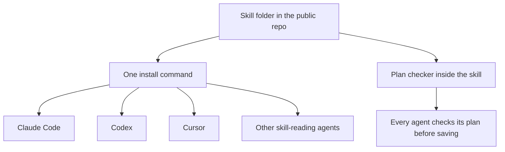
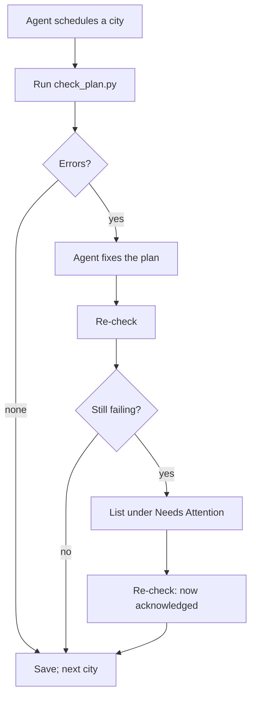

# Portable Skill Distribution - Plan

## Goal Capsule

- **Objective:** Make the travel planner one self-contained skill that installs in a single command into Claude Code, Codex, Cursor, and other skill-reading agents, checks its own output, and is validated automatically.
- **Product authority:** The Product Contract below. Chat-app delivery (claude.ai, ChatGPT) is not active scope.
- **Execution profile:** A repo restructure (moves, not rewrites), one new stdlib script inside the skill, stdlib test harnesses, methodology-doc edits, and one CI workflow. No new runtime dependencies.
- **Stop conditions:** Stop and ask before passing any "allow all commands" flag to an agent CLI, before committing (the owner requires an explicit "OK to commit"), and if a move would delete content rather than relocate it.
- **Tail ownership:** The owner publishes the GitHub repo and runs the scripted agent runs; this plan prepares both.
- **Open blockers:** None.

---

## Product Contract

### Summary

Restructure the repo so the skill folder is the product: self-contained, spec-compliant, and installable with `npx skills add` from a public GitHub repo. Make its instructions platform-neutral, add a "pick for me" mode that needs no back-and-forth, and ship a plan checker inside the skill that agents run before saving. Validate with install checks on every push and a local command that runs Claude Code and Cursor on a fixed trip.

**Product Contract preservation:** changed: R14 added and the plan-format scope boundary widened (the places record becomes one place per line so the checker can match places); R10 and the Summary say "every push" instead of "every commit", since CI runs on push; R8's meal rule is a warning, not a failure. All approved during planning.

### Problem Frame

The planner works only in Claude Code today, installed by symlinking a folder whose own contents are symlinks back into the repo. Installers that copy a skill folder from GitHub would copy broken links. `SKILL.md` names a Claude Code-only question tool, and the Codex and Perplexity adapter notes are unfinished stubs, so other agents get no guidance.

Nothing checks what an agent produces. Two San Diego dry runs found real defects only by hand, including a tower tour scheduled on a day it doesn't run. Every new platform multiplies that untested surface.

### Key Decisions

- **The skill folder is the single source.** Methodology docs, integration docs, and scripts live inside it; there is no build step or generated copy. Governs R1, R2, R4. (session-settled: user-approved — chosen over a generated bundle and over keeping repo links: one copy that installers can copy as-is.)
- **The plan checker ships inside the skill and agents run it.** Governs R8, R9. (session-settled: user-approved — chosen over a test-only checker: every platform catches broken plans during real sessions.)
- **A rule break passes only when it's flagged.** Governs R8, R9. (session-settled: user-approved — chosen over a checker with no exceptions: booked bookings can't always move, but they must be visible.)
- **"Pick for me" is a traveler feature with conservative defaults.** Governs R6, R7. (session-settled: user-approved — chosen over a test-only prompt format: tests exercise what travelers use.)
- **The places record lists one place per line.** Governs R14. (session-settled: user-approved — chosen over matching free prose: a script can't reliably split "X and Y (both near Z)".)
- **Install from a public GitHub repo.** Governs R3. (session-settled: user-directed — chosen over a private repo or local-only install.)
- **Validation covers install checks, the plan checker, and scripted agent runs.** Governs R10–R13. (session-settled: user-directed — chosen over also writing a manual chat-app checklist.)
- **Chat apps wait for a later round.** The long-term audience is developers and non-technical travelers; this round serves developer agents only. (session-settled: user-directed — chosen over shipping unverified claude.ai or ChatGPT packages now.)
- **Carried from earlier work:** no API keys anywhere; methodology docs name no tools or platforms; the planner runs as a skill in the conversation, not a subagent.



### Requirements

**Packaging and install**

- R1. The skill folder is self-contained: everything the agent reads or runs lives inside it, with no links pointing outside.
- R2. The skill folder meets the Agent Skills spec: `name` matches the folder, the description is valid, `SKILL.md` stays under 500 lines, and referenced files sit one level deep.
- R3. One documented command installs the skill from the public GitHub repo into Claude Code, Codex, and Cursor; the docs also give each agent's manual install location.
- R4. The repo's working rules in `CLAUDE.md` describe the new layout: methodology docs stay free of tool and platform names, and every script stays Python-stdlib-only.

**Platform-neutral behavior**

- R5. `SKILL.md` works on any agent: it uses the agent's structured question tool when one exists and a numbered list otherwise, naming Claude Code's tool only as an example.
- R6. A traveler can give all intake answers up front, optionally with picks, or say "pick for me", and get a complete plan without further questions.
- R7. In pick-for-me mode the agent chooses suggestions that fit each city's time, and restaurants when every-meal help is on; the places record labels these "chosen for you", separate from places the traveler named or picked.

**Self-checking**

- R8. A plan checker inside the skill checks any plan file against the format spec and the mechanically checkable methodology rules — at minimum: the plan converts to `.ics`; nothing is scheduled across a blocking window; every named or picked place appears on a day or under Needs Attention; city statuses match their days. It also warns, without failing, when a day has no lunch or dinner row, since travel often covers a meal.
- R9. The agent runs the checker before saving each city and the final plan. On failure it fixes the plan and re-checks; any failure it can't fix is listed under Needs Attention, never hidden.
- R14. The places record lists one place per line under each of its headings, so places can be matched against the day tables.

**Validation**

- R10. Install checks run on every push and confirm R1 and R2, and that installing into a throwaway home directory places the skill where Claude Code, Codex, and Cursor look for it.
- R11. The plan checker has its own tests: the worked example passes, and deliberately broken plans fail with a message naming the broken rule.
- R12. One local command runs the skill non-interactively in Claude Code and Cursor on a fixed, fully pre-answered pick-for-me trip, runs the checker on each resulting plan, and reports pass or fail per agent. An agent whose CLI isn't installed is reported as skipped, not failed.
- R13. Scripted-run checks are structural only — rules from R8 plus the named places being present — never specific venues, since web results change between runs.

### Acceptance Examples

- AE1. **Covers R6, R7, R12.** **Given** a San Diego trip prompt with every intake answer, Balboa Park as the must-visit place, every-meal help on, and "pick for me", **when** the local command runs it in Cursor, **then** Cursor writes a plan whose places record shows "chosen for you" entries and meal picks, and the checker passes.
- AE2. **Covers R8, R9.** **Given** an agent drafts a day with a museum visit running into the nap window, **when** it runs the checker before saving, **then** the checker names the overlap, the agent moves the visit, and the re-check passes.
- AE3. **Covers R12.** **Given** Codex isn't installed, **when** the local command runs, **then** Codex is reported as skipped and the run succeeds if Claude Code and Cursor pass.
- AE4. **Covers R1, R10.** **Given** a commit adds a link inside the skill folder pointing outside it, **when** install checks run, **then** they fail and name the link.
- AE5. **Covers R8, R9.** **Given** a booked 06:00 flight falls inside the bedtime window and Needs Attention names it, **when** the checker runs, **then** it reports the overlap as acknowledged and passes.

### Scope Boundaries

**Deferred for later**

- Chat-app delivery — a claude.ai skill upload, a ChatGPT version, and their manual test checklist.
- Scripted runs for Codex and Gemini CLI; they join R12 once their CLIs are installed.
- Creating and publishing the GitHub repo itself — the traveler-facing install depends on it, but publishing is the owner's step.

**Outside this work**

- An MCP server or a standalone agent app.
- Changes to the methodology's content or plan format beyond pick-for-me mode, the "chosen for you" label, and the one-place-per-line places record.

**Deferred to Follow-Up Work**

- Versioned releases (git tags) and a pinned-version install command.
- Mechanical checks beyond the R8 minimum, such as opening days, which need live data a script doesn't have.

### Dependencies / Assumptions

- The Vercel `skills` installer finds skills under `skills/<name>/`, takes `--skill`, `-a claude-code|codex|cursor`, `-g`, `-y`, and `--copy`, and installs globally to `~/.claude/skills/`, `~/.codex/skills/`, and `~/.cursor/skills/` (per its README). Not yet run locally.
- Cursor's docs say it loads project skills from `.agents/skills/`, `.cursor/skills/`, and `.claude/skills/`.
- `claude` and `cursor-agent` are installed on the owner's machine; `codex` and `gemini` are not (checked 2026-10-13).
- The public repo will be `dsh971/travel-planner2`, from the local git user name; change it in one place if the owner publishes elsewhere.
- Scripted runs use the owner's Claude and Cursor subscriptions, so they run locally on demand, not in CI.

### Sources

- Current skill and adapters: `adapters/claude-code/skills/travel-planner/SKILL.md`, `adapters/claude-code/README.md`, `adapters/codex/README.md`, `adapters/claude-ai/README.md`, `adapters/perplexity/README.md`.
- Repo rules and converter: `CLAUDE.md`, `tools/md-to-ics/md_to_ics.py`, `core/output-format-spec.md`.
- Prior planning work: `docs/plans/2026-10-12-001-feat-anchor-first-planning-plan.md`.
- Agent Skills specification: https://agentskills.io/specification
- Distribution model followed: https://printingpress.dev/ and https://github.com/mvanhorn/printing-press-library
- Installer: https://cdn.jsdelivr.net/npm/skills@1.5.22/README.md
- Agent skill locations: https://cursor.com/docs/skills and https://developers.openai.com/codex/skills.md

---

## Planning Contract

### Key Technical Decisions

- KTD1. **Layout follows the spec: `skills/travel-planner/` holds `SKILL.md`, `references/`, `integrations/`, and `scripts/`.** `core/` becomes `references/`, `integrations/` moves in unchanged, and `tools/md-to-ics/md_to_ics.py` becomes `scripts/md_to_ics.py`. Tests move to a top-level `tests/`, so nothing test-only ships to travelers. The installer discovers `skills/` by default. Covers R1, R2.
- KTD2. **Moves use `git mv` so history follows each file, and every internal link is rewritten in the same unit.** Links between methodology docs stay relative (`city-planning-loop.md`, `../integrations/...`); the repo's older plans in `docs/plans/` keep their historical paths unedited.
- KTD3. **Spec conformance is checked by a stdlib test, not the reference `skills-ref` package.** The reference validator is a pip package; the repo's stdlib-only rule (R4) wins. The test checks the subset this skill relies on: name pattern and folder match, description length 1–1024, `SKILL.md` under 500 lines, no symlinks, and every path named in `SKILL.md` and the reference docs resolving inside the folder.
- KTD4. **The `CLAUDE.md` purity grep becomes a test.** The same pattern, `claude|codex|perplexity|google|goat|tabelog`, runs against `references/` inside the package test, so the rule is enforced rather than remembered.
- KTD5. **`check_plan.py` imports `md_to_ics.py` from its own folder** and reuses its day and table parsing; conversion runs in memory. Frontmatter lists (`pacing_windows`, `cities`) need a small indentation-based reader for exactly the shapes `references/output-format-spec.md` documents — no general YAML. The converter's day parsing drops the heading's city name, so the checker reads it with its own heading pattern.
- KTD6. **Checker severities: errors fail, warnings don't, flagged errors are acknowledged.** Governs R8, R9. An error whose row title appears in the Needs Attention section is reported as acknowledged and doesn't fail the run. Missing lunch or dinner is a warning. Exit codes: 0 pass, 1 errors, 2 unreadable input.
- KTD7. **Place matching has its own rule, adapted from `references/corroboration-and-trust.md`.** A name of one or two significant words matches when it appears as a whole phrase, case-insensitive. A longer name matches when 60% or more of its significant words appear. A place matches if it matches any row's Title or Location, or any Needs Attention bullet. The methodology's exact-match rule for short names is meant for comparing two sources' names, not a name against a row title like "Visit Royal Gardens".
- KTD8. **Blocking-window overlap compares wall-clock times as written in each cell**, ignoring zone suffixes, because pacing windows are local clock times. A row is exempt when its start and end equal a blocking window's bounds (the window's own row). A blank End counts as Start plus one hour, matching the converter.
- KTD9. **Pick-for-me defaults live in `references/city-planning-loop.md`**, one per decision point, so every agent reads the same rule. The agent never books in this mode, and each default applied is recorded under Open Questions.
- KTD10. **Scripted runs install the skill into a throwaway workspace, not the owner's home.** The runner copies the folder into `<workspace>/.claude/skills/` and `<workspace>/.agents/skills/` and runs each CLI with that workspace as its working directory, so the owner's own skill installs are untouched. The workspace does not isolate the owner's home directory or logins — any CLI already signed in to a booking account stays reachable, which is why KTD11's allowlist excludes everything but the skill's own scripts.
- KTD11. **Agent CLIs run with the narrowest permissions that work.** Claude Code runs with an explicit tool allowlist and never with its skip-permissions flag. The allowlist is: read, write, and edit files; web search and web fetch; and shell access only for running the skill's `check_plan.py` and `md_to_ics.py` with `python3`. No general shell and no reservation commands. Cursor runs with `-p --trust`; if it can't run the checker without `--force`, the runner exits with that finding unless the owner passes an explicit opt-in flag for that run.
- KTD12. **Install checks run in GitHub Actions on every push**, plus the same tests locally. CI runs the stdlib tests, then installs the skill with the `skills` package pinned to `1.5.22` into a throwaway `HOME` with `--copy` and confirms the files land in all three agent folders. Locally the installer smoke is a separate script that reports skipped without `npx`.

### High-Level Technical Design

Pick-for-me mode replaces each point where the traveler would decide with a recorded default:

| Decision point | Interactive behavior | Pick-for-me default |
|---|---|---|
| Missing intake answer | Ask | Conservative default, listed in Open Questions (existing rule) |
| Which suggestions to schedule | Traveler ticks | Highest-ranked that fit the city's time; labeled "Chosen for you" |
| Named place conflicts | Traveler decides | Keep it; list in Needs Attention and Open Questions |
| Day-trip town, nap needs a bed | Traveler picks full or half day | Half day around the nap |
| Picks exceed the time | Traveler drops items | Drop lowest-ranked to "Suggested, not picked" |
| Half day or more open | Offer another round | Leave open; note in Open Questions |
| Restaurant per meal | Traveler picks or skips | Top option; "Chosen for you" in Meals |
| Reservation possible | Offer to book, confirm first | Never book; list in Open Questions |

The checker in the save path:



### Output Structure

```
skills/travel-planner/
  SKILL.md
  references/          (was core/)
  integrations/        (moved unchanged)
  scripts/
    md_to_ics.py       (was tools/md-to-ics/md_to_ics.py)
    check_plan.py      (new)
tests/
  test_md_to_ics.py    (was tools/md-to-ics/test_md_to_ics.py)
  test_check_plan.py
  test_skill_package.py
  install_smoke.py
  run_agent_smoke.py
  fixtures/
.github/workflows/checks.yml
docs/install.md
```

### Assumptions

- The installer's non-interactive `--copy` install behaves per its README; KTD12's CI step proves it on the first push.

---

## Implementation Units

### U1. Restructure into a self-contained skill folder

- **Goal:** Move everything the skill needs into `skills/travel-planner/` and tests into `tests/`, with every reference updated and no symlinks left.
- **Requirements:** R1, R4.
- **Dependencies:** None.
- **Files:**
  - Move `core/*.md` to `skills/travel-planner/references/`.
  - Move `integrations/*.md` to `skills/travel-planner/integrations/`.
  - Move `adapters/claude-code/skills/travel-planner/SKILL.md` to `skills/travel-planner/SKILL.md`.
  - Move `tools/md-to-ics/md_to_ics.py` to `skills/travel-planner/scripts/md_to_ics.py`.
  - Move `tools/md-to-ics/test_md_to_ics.py` to `tests/test_md_to_ics.py`.
  - Fold `tools/md-to-ics/README.md` into `README.md`'s calendar-export section.
  - Remove the three symlinks in the old skill folder.
  - Modify `CLAUDE.md`, `README.md`, and every moved doc's internal links.
- **Approach:**
  1. Move with `git mv` (KTD2).
  2. Rewrite links by the file's location, since each resolves from its own folder:
     - In `SKILL.md`: `core/` → `references/`, `tools/md-to-ics/md_to_ics.py` → `scripts/md_to_ics.py`.
     - Inside `references/`: `core/<doc>.md` → `<doc>.md`, `../integrations/` stays, `tools/md-to-ics/md_to_ics.py` → `../scripts/md_to_ics.py`.
     - Inside `integrations/`: `../core/` → `../references/`.
  3. Delete the maintainer sentence at the top of `references/output-format-spec.md` that names the parser and the sample; that rule lives only in `CLAUDE.md`, so the spec names nothing outside the skill folder.
  4. Point `tests/test_md_to_ics.py` at the script's new folder and the sample's path.
  5. Rewrite `CLAUDE.md` for the new layout (R4): the purity rule covers `references/`, scripts are stdlib-only, and the spec, converter, checker, and sample change together.
  6. Leave `adapters/claude-ai/`, `adapters/codex/`, `adapters/perplexity/` in place until U5 replaces them.
- **Patterns to follow:** The previous move of tool docs into `integrations/` (see `PLAN.md`, Phase 3).
- **Test scenarios:**
  - All 35 converter tests pass from `tests/`.
  - The sample converts to 31 events with the moved script.
  - No path in the repo outside `docs/plans/` and `PLAN.md` still names `core/`, `tools/md-to-ics/`, or `adapters/claude-code/`.
- **Verification:** The skill folder has no symlinks, and the converter tests and sample conversion pass from the new paths.

### U2. Package checks

- **Goal:** A stdlib test that proves the skill folder is self-contained and spec-conformant, and enforces the methodology purity rule.
- **Requirements:** R1, R2, R10 (static half), AE4.
- **Dependencies:** U1.
- **Files:** Create `tests/test_skill_package.py`.
- **Approach:** Implement the subset in KTD3 and the purity grep in KTD4. Parse backticked tokens matching `^[A-Za-z0-9_][A-Za-z0-9_./-]*\.(md|py)$` from `SKILL.md` and every reference doc (so placeholders like `<a reasonable filename>.md` are not treated as paths), resolve each against the referring file's folder, and fail on any that land outside the skill folder or don't exist.
- **Test scenarios:**
  - The real skill folder passes every check.
  - Covers AE4. A temporary copy with a symlink pointing outside the folder fails and names the link.
  - A copy whose `name` doesn't match its folder fails.
  - A copy with a description over 1024 characters fails.
  - A copy whose `SKILL.md` names a missing reference file fails and names the path.
  - A copy whose reference doc mentions a tool name fails the purity check and names the file.
- **Verification:** The package test passes on the real folder and each broken copy fails with the specific rule.

### U3. Plan checker

- **Goal:** `scripts/check_plan.py` checks any plan file against R8's rules, with the spec and sample updated to the formats it reads.
- **Requirements:** R8, R11, R14, AE2, AE5.
- **Dependencies:** U1.
- **Files:**
  - Create `skills/travel-planner/scripts/check_plan.py`.
  - Create `tests/test_check_plan.py` and `tests/fixtures/` (broken plans).
  - Modify `skills/travel-planner/references/output-format-spec.md`: one place per line in the places record (R14), each line `- <Place name>` with an optional trailing parenthetical the checker ignores; a **Chosen for you** heading (R7); Meals lines as `Day N lunch|dinner: <restaurant>` with an optional parenthetical, `(chosen for you)` marking a picked-for-you restaurant and `none` marking a skipped meal; meal rows titled starting "Lunch" or "Dinner" (the existing convention); and a note that the checker reads these.
  - Modify `examples/trip-plans/sample-trip-lilliput.md` to the one-place-per-line record.
- **Approach:**
  1. Reuse the converter's parsing (KTD5); a conversion error is a checker error.
  2. Blocking windows per KTD8; place matching per KTD7; severities and acknowledgment per KTD6.
  3. Meals: each day without a Lunch or Dinner row gets a warning. Each Meals line other than `none` must match that day's Lunch or Dinner row.
  4. Cities: with zero or one city, every day belongs to it and the heading-name check is skipped. Otherwise every date in a city's range has a heading naming that city, and each heading's date falls in its city's range. A `planned` city has a places record.
  5. Print one line per finding naming day, row, and rule, then a summary line.
- **Execution note:** Write each broken-plan fixture and its failing test before the rule that catches it.
- **Patterns to follow:** `skills/travel-planner/scripts/md_to_ics.py` for error style (`TripPlanError` with a location) and CLI shape; the converter tests' `plan()`/`day()` helpers for building fixtures.
- **Test scenarios:**
  - The Lilliput sample passes with no errors.
  - Covers AE2. A row 14:00–15:30 on a day with a 13:00–15:00 nap window fails, naming the row and window.
  - A 06:00 row on a day with a 19:30–07:00 bedtime window fails.
  - Covers AE5. The same overlap passes as acknowledged when Needs Attention names the row's title.
  - The nap row itself (13:00–15:00) is not reported.
  - A place under "Picked from suggestions" that appears on no day and not in Needs Attention fails, naming the place.
  - "Royal Gardens" matches a row titled "Visit Royal Gardens".
  - A "Chosen for you" place is checked the same as a picked one.
  - A day with no Dinner row produces a warning and exit code 0.
  - A one-city plan with no `cities` list and no city in its headings passes.
  - A place line "Royal Gardens (attraction)" is matched as "Royal Gardens".
  - A Meals line naming a restaurant with no matching row on that day fails; a `none` Meals line is ignored.
  - A `planned` city with no places record fails.
  - A day heading dated outside its city's range fails.
  - A plan with a malformed day table fails with the converter's message.
  - A missing file exits 2.
- **Verification:** All checker tests pass; the sample passes; each fixture fails on exactly its intended rule.

### U4. Platform-neutral skill and pick-for-me mode

- **Goal:** `SKILL.md` and the methodology work on any agent, support answers up front and "pick for me", and run the checker before every save.
- **Requirements:** R5, R6, R7, R9.
- **Dependencies:** U1, U3.
- **Files:**
  - Modify `skills/travel-planner/SKILL.md`.
  - Modify `skills/travel-planner/references/intake-questions.md`.
  - Modify `skills/travel-planner/references/city-planning-loop.md`.
  - Modify `skills/travel-planner/references/output-format-spec.md` (Needs Attention acknowledges checker findings).
- **Approach:**
  1. `SKILL.md`: rewrite the question and pick-list guidance around "your structured question tool if you have one, otherwise a numbered list", keeping Claude Code's tool and limits as one example (R5).
  2. Intake: when answers arrive up front, ask only what's missing; when the traveler says "pick for me" or "don't ask", use defaults and record them (R6).
  3. Planning loop: add the pick-for-me default at each decision point from the HTD table (KTD9).
  4. Loop step 8 (naming `../scripts/check_plan.py`) and `SKILL.md` (naming `scripts/check_plan.py`): run the checker before each save; fix and re-check; list what can't be fixed under Needs Attention (R9). Without a shell, the agent applies the same rules by reading the spec.
  5. Keep `SKILL.md` under 500 lines.
- **Test scenarios:** Test expectation: none -- methodology prose; U2's package test covers line count, references, and purity, and U6's scripted runs exercise the behavior end to end.
- **Verification:** The package test passes; every pick-for-me default in the HTD table has exactly one owning statement in `references/city-planning-loop.md`.

### U5. Install docs and CI

- **Goal:** One documented install command, per-agent manual locations, and install checks on every push.
- **Requirements:** R3, R10.
- **Dependencies:** U1, U2.
- **Files:**
  - Create `docs/install.md`.
  - Create `.github/workflows/checks.yml`.
  - Create `tests/install_smoke.py`.
  - Modify `README.md` (Quick start, layout section).
  - Remove `adapters/` after its remaining content moves into `docs/install.md`.
- **Approach:**
  1. `docs/install.md`: the `npx skills add dsh971/travel-planner2 --skill travel-planner` command, manual copy locations for Claude Code, Codex, and Cursor, and a short "chat apps: not yet" note carrying forward the useful parts of the claude.ai and Perplexity notes.
  2. `tests/install_smoke.py`: run `skills@1.5.22` from the local checkout into a temporary `HOME` with `--copy -g -y -a claude-code -a codex -a cursor`, then confirm `SKILL.md`, `references/`, and both scripts exist in each agent folder; report skipped when `npx` is absent (KTD12).
  3. CI: run the stdlib tests, the sample conversion, the checker on the sample, and the install smoke on each push. The workflow declares `permissions: contents: read`, uses no secrets, pins its actions to commit SHAs, and pins a Python version of 3.10 or later.
- **Execution note:** This is mostly packaging; prove it with the install smoke run rather than unit coverage.
- **Patterns to follow:** The exact-version pinning practice in `skills/travel-planner/integrations/` (there, `@mvanhorn/printing-press-library@0.1.21`), applied to `skills@1.5.22`.
- **Test scenarios:**
  - The install smoke places the skill in all three agent folders from a local checkout.
  - Without `npx` on `PATH`, the install smoke reports skipped and exits 0.
  - Each installed copy passes the U2 package checks.
- **Verification:** The install smoke passes locally; no `adapters/` path remains outside `docs/plans/` and `PLAN.md`.

### U6. Scripted agent runs

- **Goal:** One local command that runs the skill non-interactively in Claude Code and Cursor on a fixed trip and checks the plans.
- **Requirements:** R12, R13, AE1, AE3.
- **Dependencies:** U3, U4.
- **Files:**
  - Create `tests/run_agent_smoke.py`.
  - Create `tests/fixtures/san-diego-pick-for-me.md` (the trip prompt).
- **Approach:**
  1. Create a throwaway workspace and copy the skill into it (KTD10).
  2. The prompt gives every intake answer, Balboa Park, every-meal help, "pick for me", and the output filename.
  3. Run each available CLI per KTD11, with a timeout; report skipped for any CLI not on `PATH`.
  4. On each resulting plan, run the checker, then assert Balboa Park appears, the places record has a Chosen for you entry, every city is `planned`, and `meal_help` is `every_meal` (R13).
  5. Print a per-agent table and exit non-zero only on a failure.
  6. Keep the file name outside `test_*` so unit-test discovery never runs it.
- **Execution note:** Run it once by hand after U4 and record the per-agent result; this spends the owner's subscriptions, so never wire it into CI.
- **Test scenarios:**
  - Covers AE3. With `codex` absent, the run reports Codex skipped and succeeds when the others pass.
  - Covers AE1. A Cursor run produces a plan that passes the checker and the structural assertions.
  - An agent that writes no plan file is reported as failed with that reason.
  - The Claude Code command the runner builds contains the KTD11 allowlist and no wildcard shell permission or skip-permissions flag.
  - An agent that exceeds the timeout is reported as failed, and the workspace path is printed for inspection.
- **Verification:** One real run passes for Claude Code and Cursor, or any failure is reported with its finding.

---

## Verification Contract

| Gate | Command | Applies to |
|---|---|---|
| Unit and package tests | `python3 -m unittest discover -s tests -v` | U1–U5 |
| Sample converts | `python3 skills/travel-planner/scripts/md_to_ics.py examples/trip-plans/sample-trip-lilliput.md <tmp>.ics` reports 31 events | U1, U3 |
| Sample passes the checker | `python3 skills/travel-planner/scripts/check_plan.py examples/trip-plans/sample-trip-lilliput.md` exits 0 | U3 |
| Installs everywhere | `python3 tests/install_smoke.py` passes, or reports skipped without `npx` | U5 |
| Agents produce valid plans | `python3 tests/run_agent_smoke.py` passes for each installed agent CLI | U6 (manual, owner-run) |
| No stale paths | No file outside `docs/plans/` and `PLAN.md` names `core/`, `tools/md-to-ics/`, or `adapters/claude-code/` (U1); none names `adapters/` at all (U5) | U1, U5 |

---

## Definition of Done

- Every gate in the Verification Contract passes, with the agent run recorded for Claude Code and Cursor.
- `skills/travel-planner/` contains no symlinks, and the old `core/`, `integrations/`, `tools/`, and `adapters/` folders no longer exist; their content was moved or folded, not dropped.
- `CLAUDE.md` describes the new layout and rules.
- No experimental or abandoned code remains in the diff.
- Nothing is committed without the owner's explicit "OK to commit".
